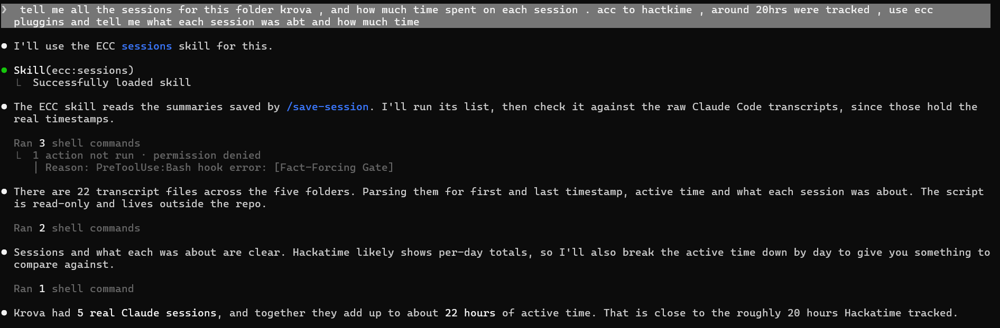
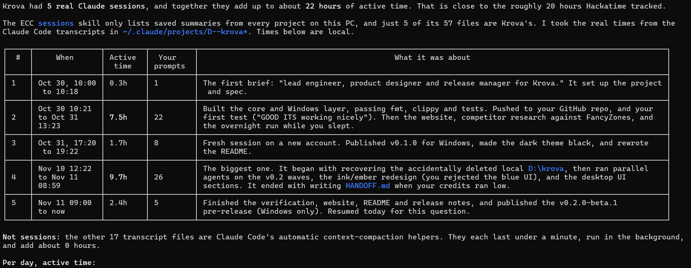
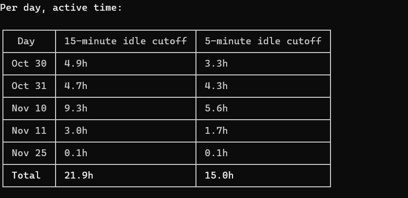
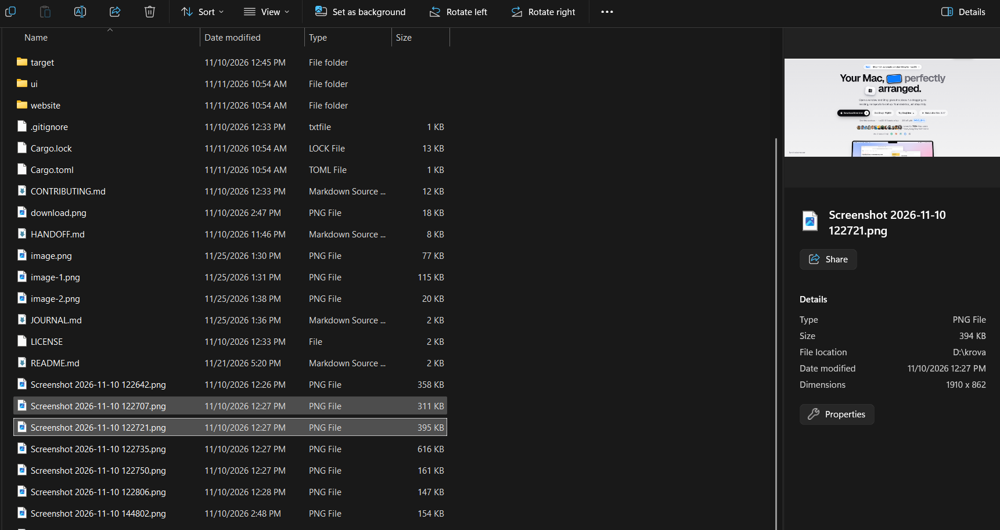

## KROVA 
Hi , I started working on Krova on Oct 30 . 
why? - so I agree that windows alr has a tabs organiser , but atleast I belive that it sucks , it never arrange the terminals , you cant custamize it. So I made Krova , which keeps your windows dekstop organised .

## HOW I MADE IT ?
I used claude code for the whole process and pinterest to get website design references.

Krova had 5 real main sessions. Ill atttach the screenshot what each session did , using ECC pluggins which manage your claude code sesssions , history and sessions metadata 

repo link for ECC - https://github.com/affaan-m/ecc

I used multiple agents for doing the work to keep it organised 

if you'll look into the screenshot of session , 
In session 1 , I gave the MD file describing the things , that session was short.
the session In which I was very active like 2(with 22 prompts) and 4(with 26 prompts) went long bcs I had to test everything and explain each thing in detail.
the other were very small bcs of some 505 errors , so didnt included .

I also took some inspiration from a website which did a similar job but it was for mac and not open source , so just took inspiration for website layout .

PS - I got some good reviews from my friend who tried it , Tho they gave some suggestions which Ill do and fix some bugs too .