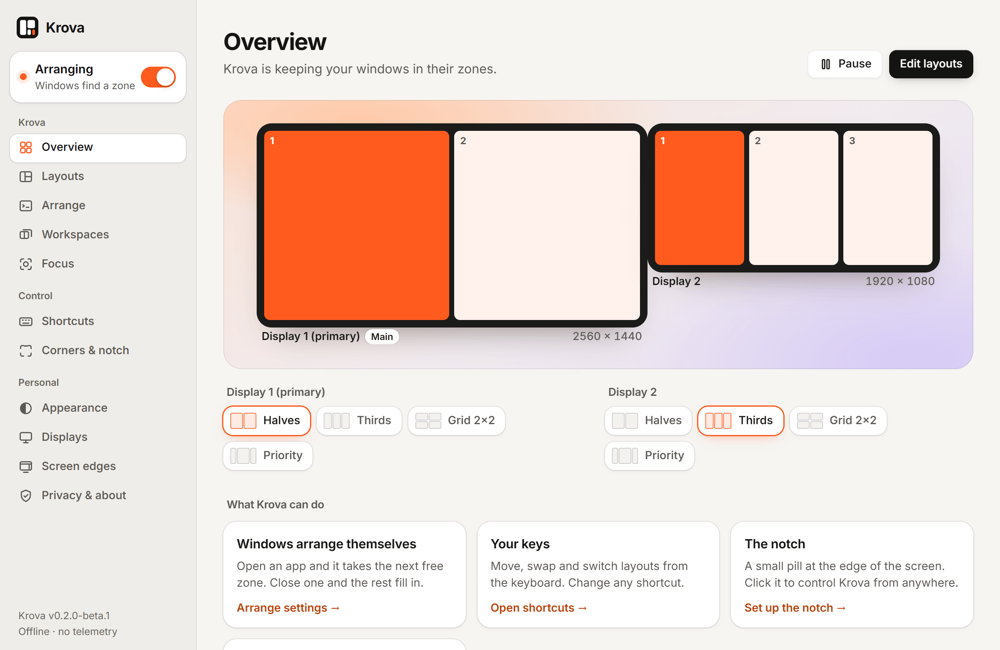

<p align="center">
  <a href="https://naitiklearn.github.io/krova/"></a>
</p>
<h1 align="center">Krova</h1>
<p align="center">
  <strong>Draw your zones. Krova keeps your windows in them.</strong><br>
  A free, offline window manager for Windows: zones, auto-arrange, stacks, workspaces and focus tools.<br>
  One small tray app. No accounts, no telemetry, no network.
</p>

<div align="center">

[](https://github.com/nAItiklearn/krova/releases)
[](https://github.com/nAItiklearn/krova/actions/workflows/ci.yml)
[](LICENSE)
[](https://naitiklearn.github.io/krova/download/)

**[Website](https://naitiklearn.github.io/krova/)** · **[Try it in your browser](https://naitiklearn.github.io/krova/demo/)** · **[Download](https://naitiklearn.github.io/krova/download/)** · **[Changelog](https://naitiklearn.github.io/krova/changelog/)**

</div>

<p align="center">
  <picture>
    <source media="(prefers-color-scheme: dark)" srcset="website/public/screenshots/app-overview-dark.png">
    
  </picture>
</p>

> [!WARNING]
> **v0.2.0-beta.1 is a test build.** Every feature passes the automated tests (unit, integration and browser tests), but the new 0.2 features have **not yet been tried by hand on a real Windows desktop**. Expect bugs, and don't rely on it for important work. The stable version is [v0.1.0](https://github.com/nAItiklearn/krova/releases/tag/v0.1.0). **macOS is not ready**: the code has never run on a Mac.

## What it does

**Zones**
- Draw zones per monitor in the layout editor, or start from presets (grid, columns, rows, main + side, with ultrawide and portrait variants). Zones are proportions, so a layout survives a resolution or scaling change.
- Hold Shift (or Ctrl, Alt or the Windows key) while dragging a window and drop it on a zone. Optional edge snapping, a gap between zones, and linked dividers (resize one window and its neighbours follow).
- Krova recognises a monitor when you reconnect it and puts your windows back in their zones.

**Arranging** (new in 0.2)
- **Auto-arrange** per monitor: new windows go to the next free zone.
- **Stacks**: when every zone is full, windows stack, with a slim tab strip showing icons and program names.
- **Swap** two windows, and **app rules** by program name: never touch, always float, or a preferred zone.

**Control** (new in 0.2)
- Keyboard shortcuts for everything, each one rebindable, with clash checks and suggestions.
- A **quick panel** from the tray, a **layout switcher**, a **notch** at the top of the screen, **hot corners**, and a **hover picker** on a window's title bar.
- **Pause** from anywhere; windows stay where they are.

**Workspaces and focus** (new in 0.2)
- **Workspaces**: save the programs on screen with their zones and restore them later.
- **Focus dim**, **calm desk** (minimise what isn't in a zone), **window highlight**, **focus follows mouse** (off by default), and **share-safe** for screen sharing.
- **Reserved screen edges** for docks and bars, and an **Appearance** page for the accent colour, corner radius and border width.

## Download

1. Get `Krova-windows-x64-setup.exe` from the [v0.2.0-beta.1 pre-release](https://github.com/nAItiklearn/krova/releases/tag/v0.2.0-beta.1), or the stable [v0.1.0](https://github.com/nAItiklearn/krova/releases/tag/v0.1.0). Windows 10/11, 64-bit, per-user, no administrator rights. Check it against `SHA256SUMS.txt` if you like.
2. The installer is **unsigned**, so SmartScreen says "Windows protected your PC". Choose **More info**, then **Run anyway**.
3. Krova starts in the notification area. Click the tray icon for the quick panel, or right-click it to open the settings.

Or [try the settings app in your browser](https://naitiklearn.github.io/krova/demo/) (demo mode, nothing is saved).

## Default shortcuts

Every one can be changed or switched off in **Shortcuts**.

| Shortcut | Action |
| :--- | :--- |
| `Ctrl+Alt+Arrow` | Move the focused window to the next zone that way (past the edge, onto the next monitor) |
| `Ctrl+Alt+Shift+Arrow` | Swap with the window in the next zone |
| `Ctrl+Alt+1` … `9` | Send the window to zone 1–9 |
| `Ctrl+Alt+Shift+1` … `9` | Apply layout 1–9 on the monitor under the cursor |
| `Ctrl+Alt+Enter` | Fill the screen; press again to go back into the zone |
| `Ctrl+Alt+[` / `]` | Previous / next window in a stack |
| `Ctrl+Alt+Space` | Layout switcher |
| `Ctrl+Alt+/` | Show every shortcut |
| `Ctrl+Alt+T` | Pause / resume |
| `Ctrl+Alt+F` | Focus dim |

`Ctrl+Alt+Left` / `Right` are "back / forward" in some IDEs, and older Intel graphics drivers use `Ctrl+Alt+Arrow` to rotate the screen. If Windows refuses a shortcut, the Shortcuts page says so and suggests free ones.

## Privacy

- Krova makes no network calls: no accounts, no telemetry, no crash reports, no update checks. "Check for updates" just opens the releases page in your browser.
- Window titles are never read, logged or stored. Krova identifies programs by their executable name only (for app rules and stack tabs). Workspaces store program paths and zones, nothing else.
- Krova watches the cursor position for hot corners, the hover picker and focus follows mouse, only while those features are on, and keeps nothing.
- The shortcuts are global hot keys: Windows tells Krova only that one of its own combinations was pressed. It does not read your other keystrokes.
- Window memory (which window is in which zone) lives in memory only and is gone when Krova quits.
- Settings, layouts, app rules and workspaces live in one local file, `config.json`, in your application-data folder. Delete it to erase everything.
- Share-safe hides program and layout names in Krova's own windows and keeps its panel, switcher and picker out of screen captures.

You can check this: the Cargo manifests list no HTTP client, socket library or updater, and the window's Content-Security-Policy allows connections only to itself and the app's IPC. An AI security review is in [docs/SECURITY-REVIEW.md](docs/SECURITY-REVIEW.md) and its findings were fixed; no independent human audit has been done. The longer version is the website's [privacy page](https://naitiklearn.github.io/krova/privacy/).

## Performance

The settings window runs in WebView2 only while it's open; close it and the browser processes exit, so the tray app is one small process. The quick panel, switcher and picker are separate lightweight windows.

Measured on **v0.1.0** with [`docs/measurements/measure-idle.ps1`](docs/measurements/measure-idle.ps1): Windows 11, AMD Ryzen 5 5625U, 60 seconds idle, one sample every 2 seconds.

| State | Processes | Private memory (median) | CPU, % of one core (average / peak) |
| :---- | :---- | :---- | :---- |
| Tray only, no window | 1 | 2.4 MB | 0.34% / 2.1% |
| Editor window open | 7 | 199 MB | 0.49% / 6.1% |

<p align="center">
  
  &emsp;
  
</p>

v0.2 has **not been measured yet**. Its new features are built to cost nothing while idle (no timers between events), but that hasn't been confirmed on a real desktop. These are single runs on one PC, not a benchmark against other tools. Raw data: [`idle-2026-10-31-tray.txt`](docs/measurements/idle-2026-10-31-tray.txt), [`idle-2026-10-31-editor.txt`](docs/measurements/idle-2026-10-31-editor.txt).

## Status

- **Windows:** v0.1.0 has been run on Windows 11. v0.2.0-beta.1 passes every automated check: Rust unit and integration tests, UI unit tests, and browser tests of every settings page against a mock backend, including accessibility scans in light and dark. The hands-on test list for 0.2 is in [docs/PROGRESS.md](docs/PROGRESS.md) and hasn't been run yet.
- **macOS:** compiles and passes `clippy` in CI, but has **never run on a Mac**. No download.
- **Linux:** not supported (the core crates build and test there).
- **Known limits:** windows of programs running as administrator are skipped; some programs enforce a minimum size; focus follows mouse may be blocked by Windows' foreground rules; languages other than English show English text for now; the installer is unsigned.

## Build from source

You need Rust, Node, and the WebView2 runtime (built into Windows 11). CI uses the MSVC toolchain; the Windows-GNU toolchain also works with a current MinGW-w64 (for example WinLibs) first on `PATH`.

The Tauri config has no `beforeBuildCommand`, so build the UI first, from the repo root:

```
npm ci --prefix ui
npm run build --prefix ui
npx -y @tauri-apps/cli@2 build --bundles nsis
```

For development, run `npm run dev --prefix ui` in one terminal and `npx -y @tauri-apps/cli@2 dev` in another. To try only the UI in a browser against fake monitors: `npm run demo --prefix ui`, then open <http://localhost:1420>.

### Verify

What CI runs:

```
cargo fmt --all -- --check
cargo clippy --workspace --all-targets -- -D warnings
cargo test --workspace

npm run build --prefix ui
cargo fmt --manifest-path src-tauri/Cargo.toml -- --check
cargo clippy --manifest-path src-tauri/Cargo.toml --all-targets -- -D warnings
cargo test --manifest-path src-tauri/Cargo.toml

npm run check --prefix ui
npm test --prefix ui
```

Browser tests: `npm run e2e --prefix ui` (see [ui/e2e/README.md](ui/e2e/README.md)). Exact test counts are in [docs/PROGRESS.md](docs/PROGRESS.md).

### Repository layout

| Path | What it is |
| --- | --- |
| `crates/krova-core` | Pure Rust, no OS code: zones, layouts, presets, placement, auto-arrange and stack logic, shortcuts, config. `#![forbid(unsafe_code)]`. |
| `crates/krova-platform` | The OS layer behind a `Platform` trait: Windows and macOS implementations, plus a stub for other systems. |
| `src-tauri` | The Tauri 2 app: tray, commands, the engine, the popup windows. Its own Cargo workspace. |
| `ui` | Svelte 5 + Vite + TypeScript: the settings app and the panel, switcher and picker pages. Also runs in a browser in demo mode. |
| `website` | The static Astro site, deployed to GitHub Pages by `.github/workflows/pages.yml`. |
| `docs` | [SPEC](docs/SPEC.md), [ROADMAP](docs/ROADMAP.md), [PROGRESS](docs/PROGRESS.md), [DECISIONS](docs/DECISIONS.md), the features contract and the security review. |
| `assets/icon` | The icon source (SVG); generated icons are in `src-tauri/icons`. |

## Contributing

Bug reports and results from your setup are welcome as issues. See [CONTRIBUTING.md](CONTRIBUTING.md).

## License

MIT. See [LICENSE](LICENSE).
