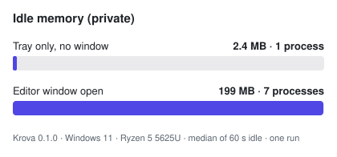
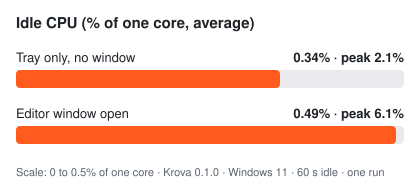

<p align="center">
  <a href="https://naitiklearn.github.io/krova/"></a>
</p>
<h1 align="center">Krova</h1>
<p align="center">
  <strong>Draw your zones. Hold Shift, drop a window in.</strong><br>
  A free, offline window zone manager. One small tray app, no accounts, no telemetry, no network.<br>
  About 2.4 MB of private memory while it waits in the tray.
</p>

<div align="center">

[](https://github.com/nAItiklearn/krova/releases/latest)
[](https://github.com/nAItiklearn/krova/actions/workflows/ci.yml)
[](LICENSE)
[](https://naitiklearn.github.io/krova/download/)
[](https://naitiklearn.github.io/krova/)

**[Website](https://naitiklearn.github.io/krova/)** · **[Try it in your browser](https://naitiklearn.github.io/krova/demo/)** · **[Download](https://naitiklearn.github.io/krova/download/)** · **[Changelog](https://naitiklearn.github.io/krova/changelog/)**

</div>

> [!WARNING]
> **Krova is not ready for everyday use yet.** v0.1.0 is an early preview for people who want to try it and report problems. It has passed its automated tests and a few hands-on runs on one Windows PC, and little else: mixed-DPI setups, unplugging and replugging monitors, the shortcuts on a physical keyboard and linked dividers with a real mouse are barely tested. Expect bugs, and do not rely on it for important work. **macOS is not ready at all**: it has never run on a Mac.

## Performance

Krova keeps its editor in an embedded browser (WebView2) only while the editor window is open. Close the window and the browser processes exit, so the app that stays in the tray is a single small process.

Measured with [`docs/measurements/measure-idle.ps1`](docs/measurements/measure-idle.ps1): the published v0.1.0 installer, Windows 11, AMD Ryzen 5 5625U, 60 seconds idle, one sample every 2 seconds.

| State | Processes | Private memory (median) | CPU, % of one core (average / peak) |
| :---- | :---- | :---- | :---- |
| Tray only, no window | 1 | 2.4 MB | 0.34% / 2.1% |
| Editor window open | 7 | 199 MB | 0.49% / 6.1% |

<p align="center">
  
  &emsp;
  
</p>

These are single runs on one PC, not a benchmark against other tools. Drag latency and resource use while dragging have not been measured yet. Raw data: [`idle-2026-10-31-tray.txt`](docs/measurements/idle-2026-10-31-tray.txt), [`idle-2026-10-31-editor.txt`](docs/measurements/idle-2026-10-31-editor.txt).

## Quick start

1. Download `Krova-windows-x64-setup.exe` from the [latest release](https://github.com/nAItiklearn/krova/releases/latest) (Windows 10/11, 64-bit, per-user, no administrator rights). Check it against `SHA256SUMS.txt` if you like.
2. The installer is **unsigned**, so SmartScreen says "Windows protected your PC". Choose **More info**, then **Run anyway**.
3. Krova starts in the notification area. Right-click the tray icon, choose **Edit layouts…**, and pick a template or split the screen into zones.
4. Drag any window while holding **Shift**. The zones of the monitor under the cursor appear; drop the window on one and it fills it.

Or skip installing and [try the editor in your browser](https://naitiklearn.github.io/krova/demo/) (demo mode, nothing is saved).

## What it does

- **Zones per monitor.** Each monitor has its own layouts. Zones are proportions of the screen, so a layout survives a change of resolution or scaling.
- **Snap by dragging.** Hold Shift (or Ctrl, Alt or the Windows key) while you drag, drop on a zone. Release the key or press Esc to cancel.
- **Keyboard zone control.** `Ctrl+Alt+Shift` plus Left or Right moves the focused window to the previous or next zone, 1 to 9 picks a zone, Up moves it to the next monitor. Other modifier combinations can be chosen.
- **Layouts and windows come back.** Krova recognises a monitor when you reconnect it, restores its layouts, and puts the windows you snapped there back into their zones (kept in memory only).
- **Linked dividers (early).** Resize a snapped window by its edge and the snapped neighbours that share that edge follow.
- **Layout files.** Export a layout as plain JSON text and import it on another monitor or PC.
- **Space between zones** from 0 to 32 px, optional **edge snapping** (halves, quarters, maximize), animated or instant moves.
- **Private by design.** No network calls, no accounts, no telemetry, no update checks. Window titles are never read or stored. See [Privacy](#privacy).

## Why Krova?

- **A zone manager on its own.** Krova does one job and stays out of the way: a tray icon, a layout editor you open when you need it, and nothing running in the background beyond one small process.
- **Nothing leaves your computer.** There is no HTTP client in the code, the editor's Content-Security-Policy allows no outside connections, and there is nothing to sign in to.
- **Open and checkable.** MIT licensed. Every number in this README comes from a measurement file in the repository, and [docs/PROGRESS.md](docs/PROGRESS.md) says plainly what has been run and what has only been written.
- **Built for both desktops.** The core is shared Rust, with a Windows layer and a macOS layer behind one interface, and layout files are meant to work on both. The macOS layer is written but has not run on a Mac yet, so there is no macOS download until it has been tested on real hardware.

The full behaviour is in [docs/SPEC.md](docs/SPEC.md). That is the design; the [Status](#status) section says what has actually been built and run.

## Status

**Version 0.1.0, an early preview released for Windows on 2026-10-31. Not ready for everyday use.** The macOS build is not released. This section is deliberately blunt. [docs/PROGRESS.md](docs/PROGRESS.md) is the detailed ledger of what has been compiled and run versus only written; read it before relying on anything here.

- **Windows:** the app has been built by CI and run on Windows 11. The tray, Shift-drag snapping, the zone editor and settings work there. The newer features (keyboard shortcuts, window memory on reconnect, linked dividers, layout files, zone gap) pass automated unit and desktop tests, but several have not been tried by hand yet: unplugging and replugging a real monitor, linked dividers with a real mouse, and mixed-DPI setups with monitors at different scaling.
- **macOS:** the code has **never run on a Mac**; nobody has opened the app there. What has been checked: the macOS layer, the core crates and the app compile and pass `clippy -D warnings` on GitHub's `macos-latest` runner, and the same lints pass locally for both macOS targets (`aarch64-apple-darwin`, `x86_64-apple-darwin`). Treat every macOS runtime behaviour as unverified. Keyboard shortcuts, window memory and linked dividers are Windows-only for now.
- **Linux:** not supported. The core crates build and test there (the platform crate falls back to a stub), but there is no Linux app.
- **UI:** the editor and settings are covered by unit tests and by browser end-to-end tests against a mock backend (both run in CI), and they run inside the real Tauri app on Windows.
- **Not done yet:** code signing and macOS notarization, drag-latency measurements, and an independent human security audit. A first security review was done by an AI reviewer and its findings were fixed; see [docs/SECURITY-REVIEW.md](docs/SECURITY-REVIEW.md).
- **Known limits:**
  - On Windows, windows of programs running as administrator are skipped, because Windows does not let a normal process move them.
  - On macOS, Krova needs the Accessibility permission (System Settings, Privacy & Security, Accessibility) before it can move other apps' windows. The mouse watcher may also need Input Monitoring on recent macOS versions; this is unverified because the macOS layer has never run.
  - Some apps refuse to be resized below a minimum size. The code is designed to keep such a window inside the work area instead of forcing it; this has had little testing on real apps.
  - Windows refuses some global shortcut combinations that include the Windows key. On the one PC this was tried on, every `Ctrl+Alt+Shift` combination (the default) registered and reacted to injected key presses, while most combinations with the Windows key were refused. If another program already holds a combination, Krova reports it in Settings instead of failing silently.

## Repository layout

| Path | What it is |
| --- | --- |
| `crates/krova-core` | Pure Rust, no OS code: zones, layouts, monitor matching, edge-snap rules, placement math, the drag state machine, layout editing and config persistence. `#![forbid(unsafe_code)]`. |
| `crates/krova-platform` | The OS layer behind a `Platform` trait: Windows and macOS implementations behind `cfg`, plus a stub for other systems. |
| `src-tauri` | The Tauri 2 app: tray, commands, the drag engine. It is its own Cargo workspace, so the root `cargo` commands do not build it. |
| `ui` | Svelte 5 + Vite + TypeScript: zone editor and settings. Also runs in a browser in demo mode. See [ui/README.md](ui/README.md). |
| `website` | The static Astro site, which embeds the real editor as a live demo. `.github/workflows/pages.yml` builds it and publishes it to GitHub Pages: <https://naitiklearn.github.io/krova/>. See [website/README.md](website/README.md). |
| `docs` | [SPEC](docs/SPEC.md), [ADR-001 (stack)](docs/ADR-001-stack.md), [PORTING-MAP](docs/PORTING-MAP.md), [PROGRESS](docs/PROGRESS.md) and [DECISIONS](docs/DECISIONS.md). |
| `assets/icon` | The icon source (SVG). The generated app icons are checked in under `src-tauri/icons`. |
| `.github/workflows` | CI (`ci.yml`), the site build and deploy (`pages.yml`) and the release workflow (`release.yml`; a `v*` tag creates a **draft** release, it never publishes by itself). |

## Try the UI in a browser (demo mode)

This needs only Node. It shows the editor and settings against fake monitors; nothing is moved and nothing is saved to a real config.

```
npm install --prefix ui
npm run demo --prefix ui
```

Then open <http://localhost:1420> (the demo uses that port; if another dev server holds it, run `npm run demo --prefix ui -- --port 5173`).

## Build and run the app on Windows

You need a Rust toolchain, Node, and the Microsoft Edge WebView2 runtime (Tauri's webview; it ships with Windows 11 and is present on most up-to-date Windows 10 systems). Tauri officially supports the MSVC toolchain, and that is what CI uses. The Windows-GNU toolchain has been used for development here: it works as long as a current MinGW-w64 (for example WinLibs) comes first on `PATH`, ahead of any old `C:\MinGW`.

The Tauri config has **no** `beforeDevCommand` / `beforeBuildCommand` hooks on purpose, so the UI is always built or served by you, from the repo root:

```
npm install --prefix ui
npm run build --prefix ui
```

Then either bundle with the Tauri CLI:

```
npx -y @tauri-apps/cli@2 build
```

or compile only the Rust app:

```
cargo build --manifest-path src-tauri/Cargo.toml
```

`cargo build` on its own produces `krova-app.exe`, but treat it as a development build: Tauri treats a build made without its CLI as one that loads the UI dev-server URL (<http://localhost:1420>) instead of the bundled files, so keep `npm run dev --prefix ui` running when you use it. For a self-contained executable or installer use the CLI build (`npx -y @tauri-apps/cli@2 build --bundles nsis`). The release workflow runs exactly that on a GitHub Windows runner, and the build it produced is the one that has been run on Windows 11.

For live development, run the UI dev server in one terminal and the app in another (the app needs the dev server because there is no `beforeDevCommand`):

```
npm run dev --prefix ui
npx -y @tauri-apps/cli@2 dev
```

The icons are checked in under `src-tauri/icons`, so a fresh clone needs no icon step. The release workflow also builds a universal macOS bundle on a GitHub runner (unsigned, never opened on a Mac); see [CONTRIBUTING.md](CONTRIBUTING.md) for the setup.

## Verify

The commands CI runs, from the repo root. The core crates:

```
cargo fmt --all -- --check
cargo clippy --workspace --all-targets -- -D warnings
cargo test --workspace
```

The app (a separate workspace, so it needs `--manifest-path`; build the UI first because Tauri embeds `ui/dist`):

```
npm run build --prefix ui
cargo fmt --manifest-path src-tauri/Cargo.toml -- --check
cargo clippy --manifest-path src-tauri/Cargo.toml --all-targets -- -D warnings
cargo test --manifest-path src-tauri/Cargo.toml
```

The UI:

```
npm run check --prefix ui
npm test --prefix ui
```

The macOS lints can be checked from a Windows or Linux machine, because clippy only type-checks and never links. For the core crates:

```
rustup target add aarch64-apple-darwin x86_64-apple-darwin
cargo clippy --workspace --all-targets --target aarch64-apple-darwin -- -D warnings
cargo clippy --workspace --all-targets --target x86_64-apple-darwin -- -D warnings
```

The app needs the same commands with `--manifest-path src-tauri/Cargo.toml`, plus a stand-in for the C compiler: one small dependency (`objc2-exception-helper`) compiles a C file in its build script. Point `CC_<target>` and `AR_<target>` (for example `CC_aarch64_apple_darwin`) at scripts that write an empty output file; clippy does not link, so that is enough.

As of 2026-10-31 all of the above pass on Windows (with the Windows-GNU toolchain). CI runs the same checks on Windows, macOS and Ubuntu; the Actions tab shows the current state. Exact test counts are in [docs/PROGRESS.md](docs/PROGRESS.md).

## Privacy

In plain words:

- Krova makes no network calls. There are no accounts, no telemetry, no crash reports and no update checks.
- Window titles are never read, logged or stored. To move a window Krova looks at the window being dragged, its position and size, and the cursor position, in memory and only at that moment.
- Window memory (Windows) keeps, in memory only, which window handle you snapped to which zone of which monitor. It is never written to disk and is gone when Krova quits. Closing a window or its monitor going away drops the entry.
- The keyboard shortcuts register global hot keys with Windows. Krova is told only that one of its own combinations was pressed; it does not read your other keystrokes. Linked dividers listen for Windows' "a window is being moved or resized" notifications, which carry no titles or content.
- Settings and layouts live in one local file, `config.json`, in your user account's application-data folder. It holds your settings and, per monitor, an identifier, a label, your layouts and the active layout. Delete the file to erase it.
- On macOS Krova asks for the Accessibility permission, and possibly Input Monitoring, which the OS requires before any app can move other apps' windows or watch the mouse. Windows needs no permission.

These are design rules written into the spec and the code's comments, and they can be checked: Krova's own Cargo manifests list no HTTP client, socket library or updater plugin, and the window's Content-Security-Policy allows connections only to itself and to the app's own IPC. A first security and privacy review by an AI reviewer is in [docs/SECURITY-REVIEW.md](docs/SECURITY-REVIEW.md) and its findings were fixed. An independent human audit has not been done. The longer version, written for end users, is the website's privacy page: [website/src/pages/privacy.astro](website/src/pages/privacy.astro).

## Contributing

See [CONTRIBUTING.md](CONTRIBUTING.md).

## License

MIT. See [LICENSE](LICENSE).
